<div align="center">

# Learning to Read Residual Images for Single-Pixel Photography

Hongjun An<sup>1</sup> · Shuaizhe An<sup>1</sup> · Tong Tian<sup>3,4</sup> · Zhe Sun<sup>1,2,&#x2217;</sup>

<sup>1</sup>School of Artificial Intelligence, Optics and Electronics (iOPEN), Northwestern Polytechnical University<br>
<sup>2</sup>Institute of Artificial Intelligence (TeleAI), China Telecom<br>
<sup>3</sup>Institute of Optics and Quantum Electronics, Abbe Center of Photonics, Friedrich Schiller University Jena<br>
<sup>4</sup>Helmholtz Institute Jena<br>
<sup>&#x2217;</sup>Corresponding author

<a href="https://cavedweller509.github.io/MGV-Flow/"></a>

<a href="https://cavedweller509.github.io/MGV-Flow/#demo"></a>
<a href="https://cavedweller509.github.io/MGV-Flow/#results"></a>
<a href="LICENSE"></a>


<a href="https://cavedweller509.github.io/MGV-Flow/">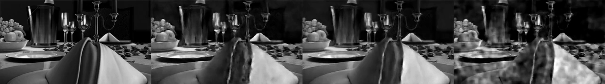</a>

<sub>Ground truth · <b>MGV-Flow (ours)</b> · History-FM · FlowDPS-inspired</sub>

</div>

Video reconstructed from **1,000 bucket values per frame**, 0.24% of the 856×480 pixels. Every five-frame block
is read from its own measurements with *K* = 5 Euler steps, and on this validation segment MGV-Flow reaches
22.41 dB against 21.85 dB for History-FM and 19.26 dB for FlowDPS-inspired.

| **0.24%** | **256×** | **+4.8 dB** | **−33%** |
|:---:|:---:|:---:|:---:|
| of the pixels measured per frame | faster than per-clip inversion | median PSNR over per-clip inversion | bucket values with directional fidelity |

## Abstract

Continuous video scales in cost with camera count, resolution and recording duration, yet many monitoring tasks seek events rather than complete images and can operate on a compact single-pixel measurement stream. Recovering a chosen interval as video is then desirable, but at 0.24% sampling the scene correlation image looks like noise and per-clip optimization takes minutes. Correlating the residual of an estimate with the coding patterns nevertheless gives a *residual image*, the gradient of a centered measurement loss. Lifted through a pretrained video decoder, its agreement with the true error exceeds that of control decoders. Video-latent inversion (VLI) then outperforms frame-wise image-latent reconstruction at 1,000 bucket values per frame. Measurement-Gradient-Conditioned Video Flow (MGV-Flow), trained once to read the lifted residual image with preceding frames, reconstructs five frames in 1.55 s at a median peak signal-to-noise ratio of 22.9 dB, against 398 s and 18.1 dB for VLI, with the largest gains in high-motion scenes. Directional fidelity ranks 30 coding configurations and selects one needing a third fewer bucket values. On a physical system, MGV-Flow outperforms per-frame reconstruction without retraining. A sliding window over the bucket-value stream yields 3.2 frames per second on one RTX 4090 and, in theory, 20 frames per second with a 0.23 s delay on one data-centre accelerator. The correlation that founded single-pixel imaging thus becomes feedback a generative model learns to read.

## How it works

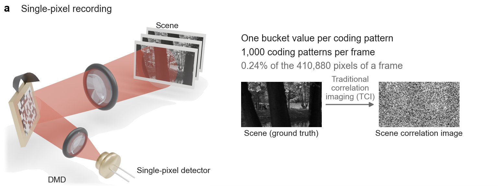

A digital micromirror device displays binary coding patterns and a single-pixel detector records one bucket
value per pattern. At 1,000 bucket values per frame, traditional correlation imaging returns noise.

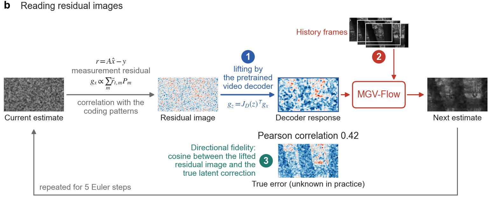

The residual between predicted and acquired bucket values, correlated with the coding patterns, is the residual
image. The transposed Jacobian of the pretrained video decoder lifts it into the latent space, and MGV-Flow
reads it with the history frames for five Euler steps.

## Rolling single-pixel photography

Rows show the full frames with per-frame PSNR, a zoom on moving content, and the absolute error. Every block of
five frames is reconstructed from its own 1,000 bucket values per frame with the five preceding frames as
history. Full-resolution videos are on the [project page](https://cavedweller509.github.io/MGV-Flow/#demo).

**Red kayak I**

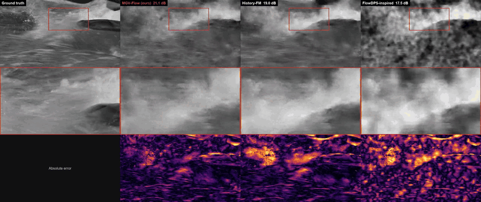

**Red kayak II**

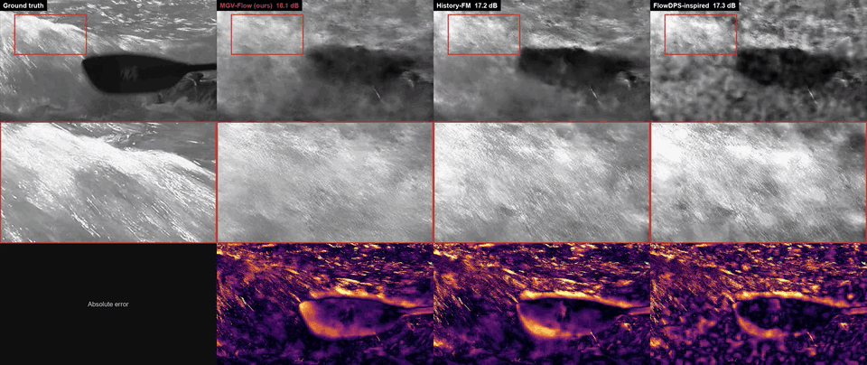

**Dinner I**

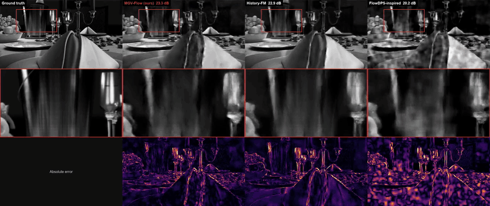

**Dinner II**

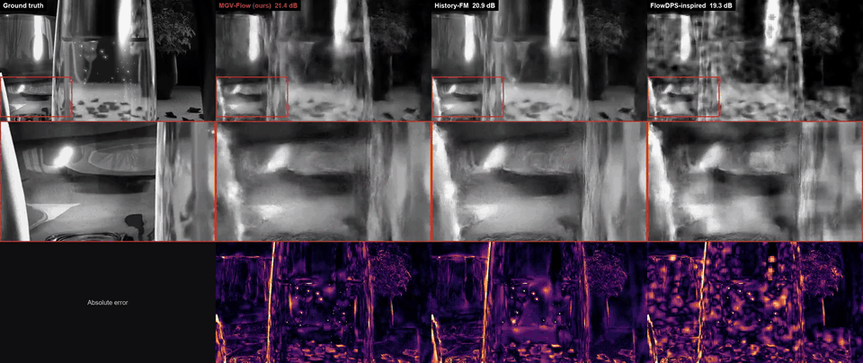

**Blue sky**

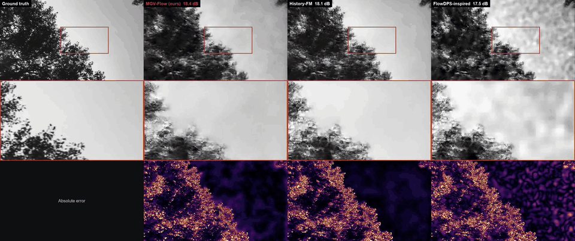

| Mean PSNR over the segment | MGV-Flow | History-FM | FlowDPS-inspired |
|---|:---:|:---:|:---:|
| Red kayak I | **22.29 dB** | 20.71 dB | 18.59 dB |
| Red kayak II | **19.18 dB** | 17.86 dB | 17.66 dB |
| Dinner I | **22.41 dB** | 21.85 dB | 19.26 dB |
| Dinner II | **22.28 dB** | 21.83 dB | 19.29 dB |
| Blue sky | **17.13 dB** | 16.75 dB | 16.38 dB |

<sub>History-FM is the same flow model conditioned on the preceding frames alone. FlowDPS-inspired adds the
measurement gradient to its velocity with a fixed weight. Red kayak clips are from the training split, dinner
clips from the validation split and blue sky from the test split.</sub>

## Results

### 1 · Lifting residual images into a video latent space makes inversion scalable

Through the pretrained video decoder, the noise-like residual image becomes a structured correction that agrees
with the true error better than through re-initialized or weight-shuffled decoders. Video-latent inversion (VLI),
which reconstructs five frames jointly in this latent space, outperforms pixel networks and frame-wise
image-latent reconstruction (GILM) when bucket values are scarce.

At 1,000 bucket values per frame, averaged over four resolutions and five test videos, VLI reaches 18.02 dB
against 16.44 dB for GILM and 11.59 dB for a U-Net. At 856×480 with 10,000 bucket values per frame, joint
inversion needs 56.3% less computation and 72.8% less peak GPU memory than GILM.

| 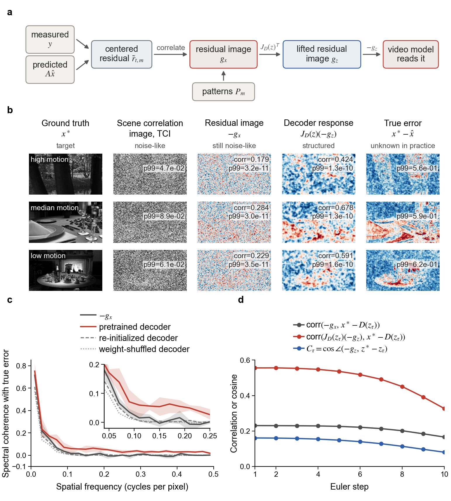 | 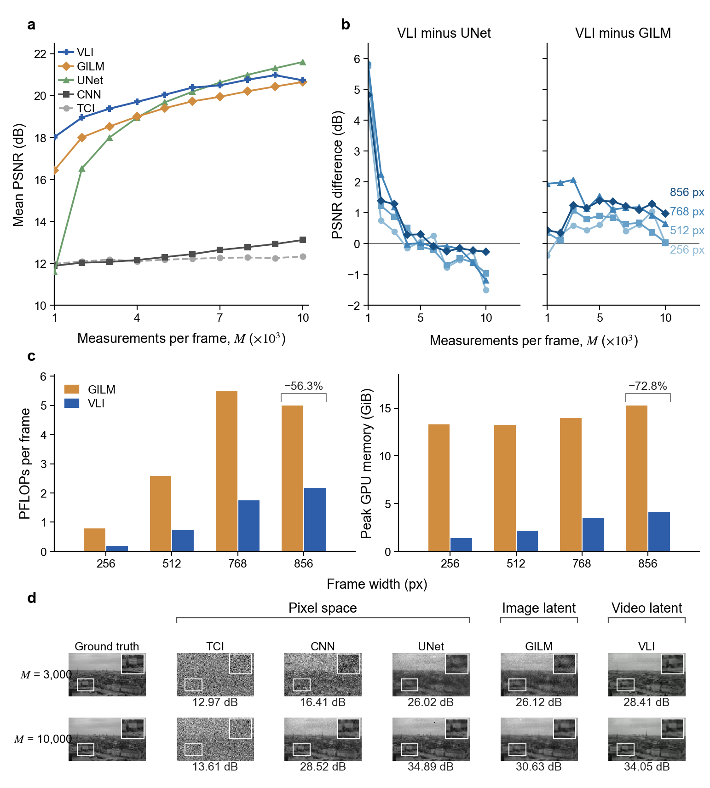 |
|:---:|:---:|
| **Figure 1.** A noise-like residual image becomes a structured video correction through the pretrained decoder. | **Figure 2.** Measurement, spatial and computational scaling across reconstruction spaces. |

### 2 · Reading instead of consuming residual images enables amortized video reconstruction

MGV-Flow is trained once to read the lifted residual image together with the history frames. A five-frame clip
takes 1.55 s at *K* = 5 instead of 397.99 s with VLI, a median speedup of 256×, while median PSNR rises from
18.12 to 22.92 dB. VLI fits the measurements far more closely, yet in none of 21 cases does it reach the PSNR of
MGV-Flow, because at 0.24% sampling many videos fit the measurements almost equally well.

Setting the measurement inputs to zero lowers PSNR by 1.57 dB and inputs from another video lower it by
0.68 dB, so the model reads the measured scene. The benefit of reading grows with motion (Spearman 0.738), where
the history predicts the target least.

| 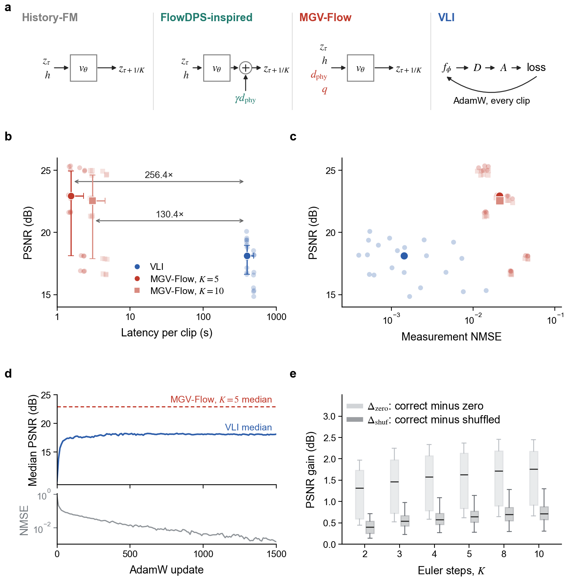 | 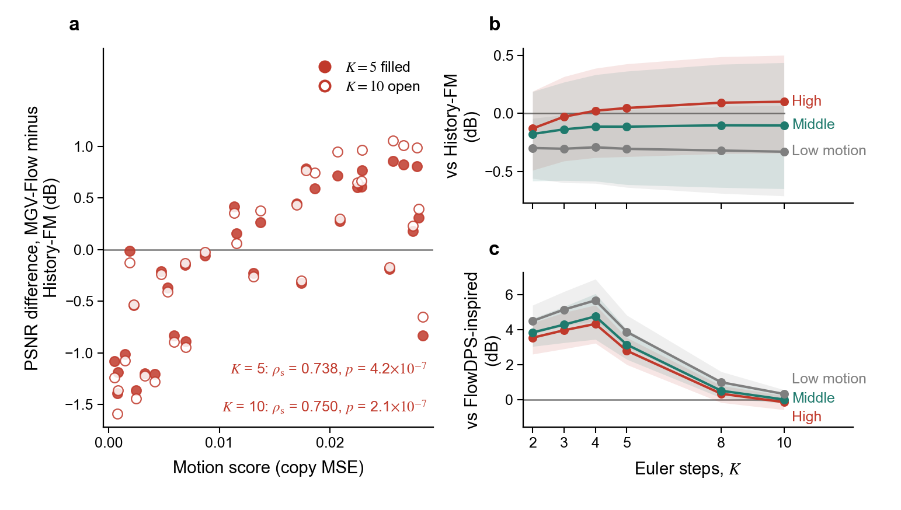 |
|:---:|:---:|
| **Figure 3.** Reading versus consuming the residual image. | **Figure 4.** Reading the residual image pays off where the history cannot predict the target. |

### 3 · Directional fidelity of residual images reveals coding-pattern utility

Directional fidelity measures whether the lifted residual image points toward the true latent correction, at the
cost of one residual image and one decoder vector-Jacobian product and without running a reconstruction. Across
30 configurations of pattern family, grain size and measurement count, it predicts reconstruction quality with a
Spearman correlation of 0.779 (95% confidence interval 0.644 to 0.862).

Ranked on calibration windows, the top configuration, a Walsh basis at 16 px, matches the median-ranked
configuration at 3,000 bucket values per frame with only 2,000 and exceeds it in all eight held-out windows. The
best pattern also depends on the video autoencoder.

| 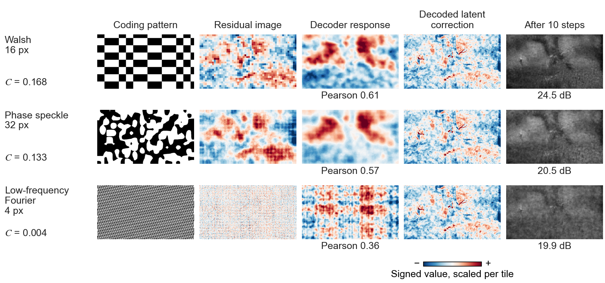 | 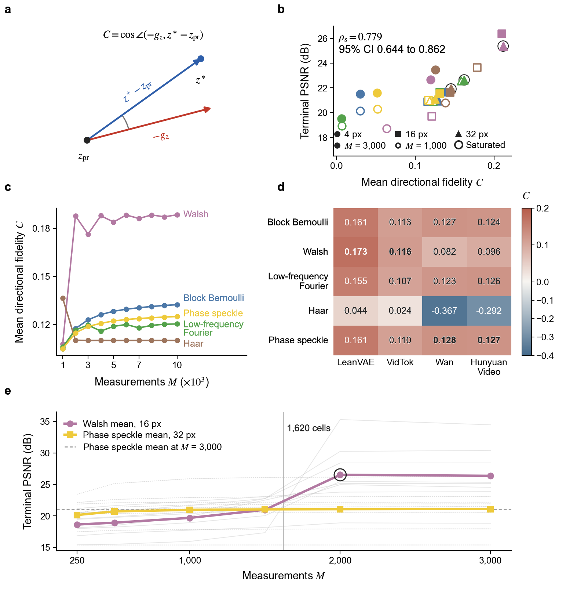 |
|:---:|:---:|
| **Figure 5.** Residual images of three coding configurations at 3,000 bucket values per frame on one held-out window. | **Figure 6.** Directional fidelity reveals coding-pattern utility. |

### 4 · On physical measurements, reading transfers without retraining

On bucket values acquired by a physical single-pixel system with structured illumination, MGV-Flow, neither
retrained nor fine-tuned, predicts frames 6 to 10 of two animated film excerpts from 10,000 measured bucket
values per frame and five ground-truth history frames. It reaches an equalized PSNR of 10.25 dB against 8.63 dB
for GILM, the best per-frame method, and produces five frames in 7.85 s while GILM needs 44.13 s for each frame.

Bucket values of the other clip lower PSNR in all six runs, and the measurement residual falls to 0.54 to 0.61 of
its initial value against 0.65 to 0.69 for the other clip, so the model reads the physical measurements.

| 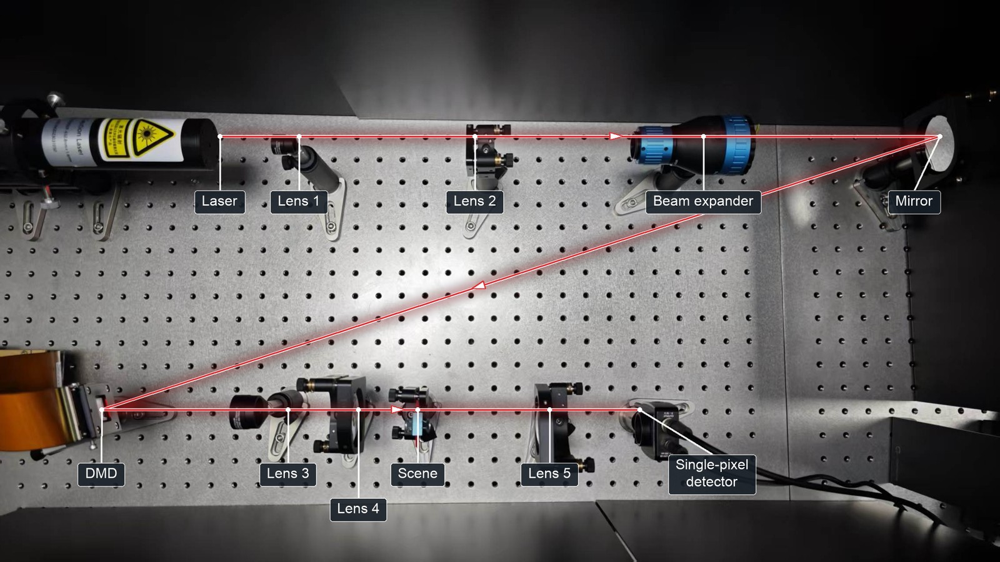 | 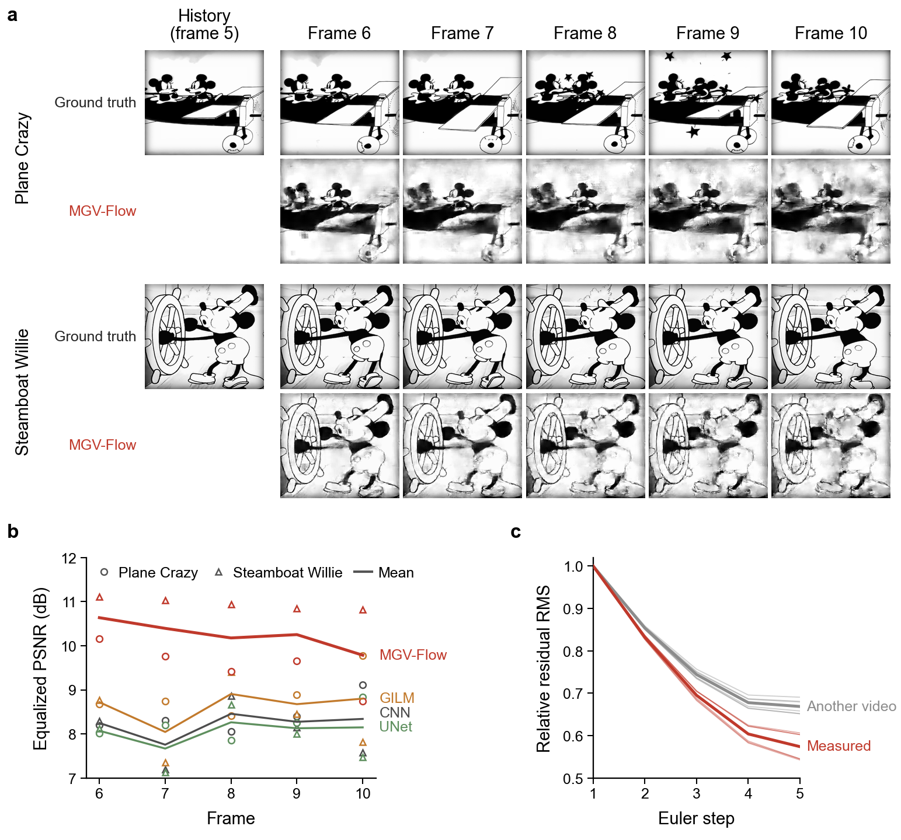 |
|:---:|:---:|
| **Figure 7.** Physical single-pixel photography system, top view. | **Figure 8.** Physical single-pixel reconstruction with 10,000 measured bucket values per frame. |

Full panel-by-panel captions are on the [project page](https://cavedweller509.github.io/MGV-Flow/#results).

## Imaging rate and compute

The detector delivers bucket values as a continuous stream, so reconstruction runs as a sliding window over the
most recent measurements, and the reconstruction delay is the latency of one five-frame block.

| Hardware | *K* = 5 | Delay |
|---|:---:|:---:|
| RTX 4090 (measured) | 3.2 fps | 1.55 s |
| RTX 3090 (scaled) | 2.0 fps | 2.51 s |
| RTX 5090 (theoretical) | 6.4 fps | 0.78 s |
| H100 (theoretical) | 10.0 fps | 0.50 s |
| B200 (theoretical) | 21.9 fps | 0.23 s |

## Code

| Module | Content |
|---|---|
| `mgvflow/physics/operator.py` | single-pixel forward operator, residual image, scene correlation image |
| `mgvflow/physics/condition.py` | lifted residual image `g_z = J_D(z)^T g_x` |
| `mgvflow/models/mgv_flow.py` | MGV-Flow and History-FM velocity network |
| `mgvflow/sampling/euler.py` | K-step Euler integration with per-step residual images |
| `mgvflow/streaming.py` | sliding-window camera over a continuous bucket-value stream |
| `mgvflow/fidelity.py` | directional fidelity and PSNR |

```bash
git clone https://github.com/cavedweller509/MGV-Flow.git
cd MGV-Flow && pip install -e ".[test]" && pytest
```

```python
import torch
from mgvflow import SinglePixelOperator

patterns = (torch.rand(5, 1000, 120, 214) > 0.5).float()   # one pattern set per frame
operator = SinglePixelOperator(patterns)
clip = torch.rand(1, 5, 120, 214)
y = operator.measure(clip)                                  # bucket values [1, 5, 1000]
g_x = operator.residual_image(torch.zeros_like(clip), y)    # residual image of an estimate
```

## Citation

```bibtex
@article{sun2026mgvflow,
  title   = {Learning to Read Residual Images for Single-Pixel Photography},
  author  = {An, Hongjun and An, Shuaizhe and Tian, Tong and Sun, Zhe},
  year    = {2026}
}
```

## Acknowledgements

We thank the authors of [LeanVAE](https://github.com/westlake-repl/LeanVAE), whose pretrained video autoencoder
provides the latent space of MGV-Flow, and of [VidTok](https://github.com/microsoft/VidTok),
[Wan](https://github.com/Wan-Video/Wan2.1) and [HunyuanVideo](https://github.com/Tencent-Hunyuan/HunyuanVideo),
whose autoencoders we use in the directional-fidelity analysis. The FlowDPS-inspired baseline follows
[FlowDPS](https://github.com/FlowDPS-Inverse/FlowDPS). Test sequences come from the
[Xiph.org Derf collection](https://media.xiph.org/video/derf/) and
[Something-Something V2](https://www.qualcomm.com/developer/software/something-something-v-2-dataset).

## License

The code in this repository is released under the [MIT License](LICENSE). Video frames shown in the demos are
derived from third-party test sequences and remain subject to the terms of their original sources.
